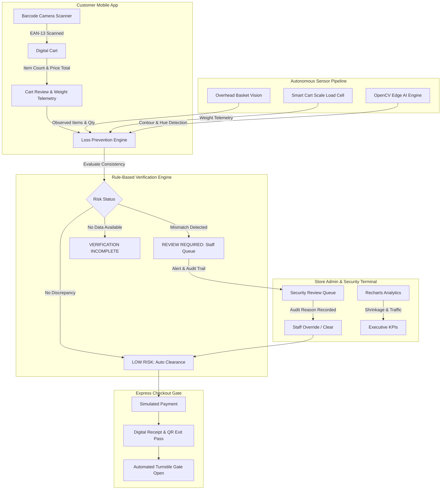

# ScanGuard AI — Smart Mobile Checkout & Retail Loss Prevention

> **“Shop Freely. Scan Smartly. Prevent Loss Intelligently.”**

ScanGuard AI is an autonomous, mobile-first retail checkout and loss-prevention platform built for modern retail. It empowers customers to scan product barcodes right off store shelves, add them to a digital basket, review live bill computations, and complete simulated checkout without waiting in line. Simultaneously, an intelligent multi-sensor loss-prevention engine continuously validates the digital cart against physical verification feeds (such as smart cart overhead vision and load-cell weight sensors) to detect and flag missed scans, quantity discrepancies, and uncatalogued items before checkout.

---

## System Architecture



---

## Key Features & Highlights

### 1. Mobile Scan & Go Experience
- **Browser-Based Barcode Scanner:** Real-time barcode reading using `html5-qrcode` with a glowing targeting reticle, camera switcher, and 2.5-second scan debouncing to prevent accidental duplicate additions.
- **Manual Barcode Fallback & Tap-to-Scan Demo Shelf:** Fast fallback for testing without requiring physical barcodes on hand.
- **24-Product Supermarket Catalogue:** Spread across Groceries, Beverages, Snacks, Personal Care, and Household Essentials with high-definition product images, barcodes, and gram weights.
- **Server-Side Calculated Billing:** Subtotal, sales tax (8%), and final total calculated programmatically on the backend—never trusting client-submitted prices.

### 2. Multi-Sensor Loss-Prevention Engine
- **Deterministic & Decoupled:** Fully testable rule-based engine comparing digital cart records against overhead vision and load-cell scale data.
- **Three Clear Verification States:**
  - `LOW_RISK`: All physical items match digital cart records.
  - `REVIEW_REQUIRED`: Discrepancy detected (e.g., missed scan, extra units, unknown barcode).
  - `VERIFICATION_INCOMPLETE`: Insufficient sensor evidence received.
- **Edge AI Verification Module:** Built with Python and OpenCV, performing Canny edge contour extraction, HSV color classification, and packaging bounding-box analysis.

### 3. Store Admin & Security Operations Dashboard
- **Live Security Queue:** Real-time visibility into flagged shopping sessions at self-checkout gates.
- **Audited Discrepancy Resolution:** Allows store staff to inspect discrepancies, select resolution reasons (e.g., *"Customer scanned missing item"*, *"False alarm - verified clear"*), input associate credentials, and clear the session.
- **Interactive Recharts Analytics:**
  - Hourly Scans & Volume AreaChart
  - Discrepancy Breakdown by Trigger Type BarChart
  - Resolution Out-turn Statistics
- **Catalogue & Inventory Management:** Live stock tracker and price auditor.

### 4. Interactive Hackathon Demo Controls
- **One-Click Scenario Triggers:**
  - **Scenario 1 (Clean Cart):** Rice, Milk, Soap matched 100% $\to$ `LOW_RISK` $\to$ Instant checkout.
  - **Scenario 2 (Missed Scan):** Rice, Milk, Soap in cart, but overhead vision detects unscanned Shortbread Biscuits $\to$ `REVIEW_REQUIRED`.
  - **Scenario 3 (Quantity Mismatch):** 1 carton of Milk in cart, but sensors detect 2 cartons $\to$ `REVIEW_REQUIRED`.
  - **Scenario 4 (Unknown Barcode):** Malformed / uncatalogued barcode $\to$ `REVIEW_REQUIRED`.
  - **Scenario 5 (Staff Resolution):** Discrepancy flagged and verified/approved by store associate $\to$ `LOW_RISK`.
- **View Modes:**
  - **Shopper Mobile View:** Smartphone frame interface.
  - **Admin Dashboard:** Fullscreen security operations terminal.
  - **Dual Presentation View:** Side-by-side split screen showing customer phone on the left and security terminal on the right.

---

## Technology Stack

| Layer | Technologies Used |
|---|---|
| **Frontend** | React 19, TypeScript, Vite, Tailwind CSS, Lucide React, Recharts, Canvas Confetti, HTML5-QRCode |
| **Backend** | Python 3.14, FastAPI, SQLAlchemy ORM, Uvicorn, Pydantic |
| **Database** | SQLite with WAL mode and foreign key integrity |
| **Computer Vision** | OpenCV (`cv2`), NumPy, Pillow |
| **Testing** | Pytest (Unit tests), Custom E2E API Verification Suite |

---

## Directory Structure

```
scanguard/
├── backend/
│   ├── main.py                   # FastAPI REST API & route handlers
│   ├── database.py               # SQLite connection & WAL pragma
│   ├── models.py                 # SQLAlchemy ORM models & Pydantic schemas
│   ├── engine.py                 # Deterministic loss-prevention rule engine
│   ├── cv_verifier.py            # OpenCV computer vision frame analyzer
│   ├── seed_data.py              # 24-product retail catalogue & sample transactions
│   ├── test_loss_prevention.py   # Pytest unit tests for verification engine
│   └── verify_e2e.py             # 10-step end-to-end integration test suite
├── frontend/
│   ├── src/
│   │   ├── components/
│   │   │   ├── DemoControlBar.tsx      # Hackathon demo bar & view mode switcher
│   │   │   ├── WelcomePage.tsx         # Page 1: Welcome & Login
│   │   │   ├── ShoppingHomePage.tsx    # Page 2: Product Catalogue & Search
│   │   │   ├── BarcodeScannerPage.tsx  # Page 3: Live Camera Barcode Scanner
│   │   │   ├── CartPage.tsx            # Page 4: Digital Cart & Weight Telemetry
│   │   │   ├── VerificationPage.tsx    # Page 5: Loss Prevention Risk Center
│   │   │   ├── CheckoutPage.tsx        # Page 6: Payment & Digital Receipt
│   │   │   └── AdminDashboard.tsx      # Page 7: Security Queue & Analytics
│   │   ├── types.ts                    # Shared TypeScript interfaces
│   │   ├── api.ts                      # Typed REST client
│   │   ├── App.tsx                     # Main layout & router
│   │   ├── main.tsx                    # React root entry
│   │   └── index.css                   # Tailwind tokens & dark navy theme
│   ├── tailwind.config.js
│   ├── postcss.config.js
│   ├── vite.config.ts
│   └── package.json
└── README.md
```

---

## Quick Start & Running Locally

### 1. Start the FastAPI Backend

Open a terminal in the project directory:

```bash
cd backend
python -m uvicorn main:app --host 127.0.0.1 --port 8000 --reload
```
The backend API and interactive OpenAPI documentation will be accessible at:
- **API Base:** `http://127.0.0.1:8000`
- **Swagger Docs:** `http://127.0.0.1:8000/docs`

### 2. Start the React + Vite Frontend

In another terminal:

```bash
cd frontend
npm install
npm run dev -- --host 127.0.0.1 --port 5173
```
Open **`http://127.0.0.1:5173/`** in your browser.

---

## Running the Automated Test Suites

### 1. Loss Prevention Engine Unit Tests (Pytest)
Runs deterministic unit tests verifying clean carts, extra observed items, quantity mismatches, unknown barcodes, empty carts, and missing data:

```bash
python -m pytest backend/test_loss_prevention.py -v
```
*(Result: 7 passed in 0.08s)*

### 2. End-to-End API Integration Suite
Runs automated verification across the frontend, product catalogue, barcode lookup, demo scenarios 1 through 5, and checkout receipts:

```bash
python backend/verify_e2e.py
```
*(Result: 10/10 passed with 100% accuracy)*

---

## Acceptance Criteria Verification Checklist

- [x] **Product Browsing:** 24 realistic products with high-resolution images, barcodes, prices, and weights across 5 categories.
- [x] **Barcode Scanning:** Live camera feed with reticle, debouncing, and manual barcode entry fallback.
- [x] **Cart Management:** Add, remove, update quantities, programmatically computed subtotal, 8% tax, and total.
- [x] **Loss Prevention Engine:** Detects missed scans, quantity mismatches, unknown barcodes, and clean baskets.
- [x] **Incomplete Data Handling:** Correctly flags `VERIFICATION_INCOMPLETE` without generating false alarms.
- [x] **Simulated Checkout & Gate Pass:** Blocks unverified carts, clears approved checkouts, generates digital receipt and QR exit pass.
- [x] **Store Admin Dashboard:** KPI metrics, live security review queue, audit resolution logging, and Recharts analytics.
- [x] **Hackathon Demo Controls:** 5 instant 1-click test scenarios plus Reset Demo button.
- [x] **Dual Presentation Mode:** Responsive single view or side-by-side split screen for hackathon demonstrations.
